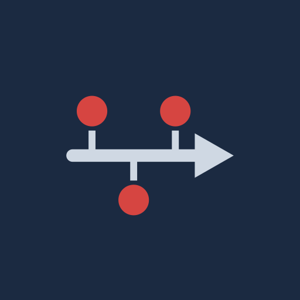
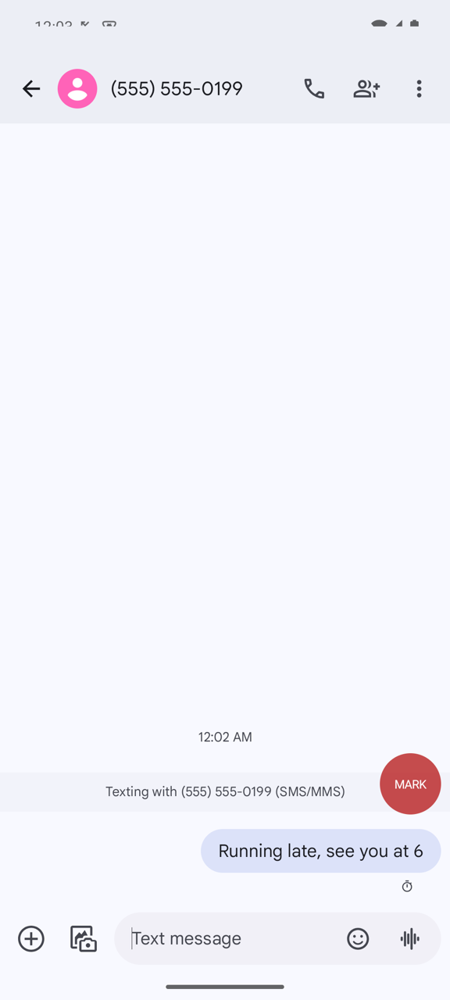
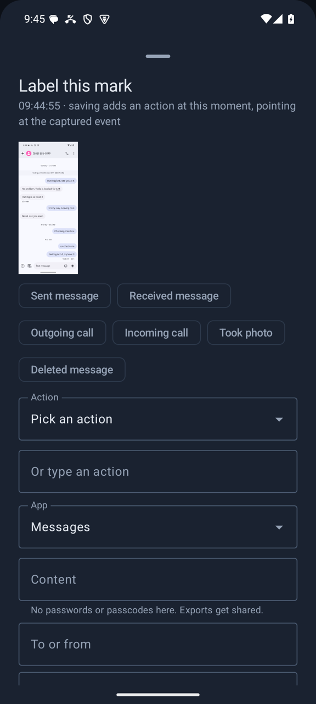

<p align="center"></p>

# Known-data logger

KDL (Known-data logger) is an Android app for test phones. Turn on capture and use the phone as
you normally would. KDL writes down what you did and when: taps, typed text, screens, incoming
messages and calls, and a screenshot each time you tap MARK. At the end you export a hash-chained
log, and a script turns it into a spreadsheet, so anyone validating a forensic tool can check each
action against what the tool reports.

## Who it is for

Examiners and tool developers who need known data from a test phone. Test phones only, with test
accounts. Never install it on an evidence device.

KDL watches the screen through Android's accessibility service. It never opens another app's data,
and it never records what is typed into a password field. It has no network permission and asks
for no runtime permissions.

It does leave traces on the test phone, and an extraction will show them: the accessibility
service in the secure settings, its database, a live copy of every row (typed text included) that
stays on the phone after an export, and the export folder you pick. Section 11 of the manual lists
them all.

## Get it

Download `KDL-<version>.apk` and `SHA256SUMS` from
[Releases](https://github.com/abrignoni/known-data-logger/releases). Check the hash, then install
it with adb:

```bash
adb install KDL-<version>.apk
```

The manual has the signer check, the install from a file on the phone, and how to install into a
second user profile. The spreadsheet script needs Python 3 with `openpyxl`, from the release's source
code or this repository.

## What you get

| MARK over the app under test | Labelling a mark from its screen text |
|---|---|
|  |  |

After a session, the Check tab lists what KDL inferred or could not label, with its screenshot when
it has one. Edits
never overwrite: each one is a new revision, and the action keeps its time. The export holds every
row and every screenshot, and from 0.5.0 the view tree saved with it. `make_documentation.py`
turns it into a workbook with a sheet per app. Every row is hashed with the one before it, so a
changed or removed row breaks the chain. Write down the latest row hash from the Setup tab: it
catches rows cut off the end.

KDL ships rules for Google Messages and the AOSP Camera, and after 0.5.0 for Instagram. For other
apps, teach a rule from a capture in the app, or log by hand. Rules can be exported and shared.

For an app no LEAPP parses yet, `kdl_locate.py` looks for where the app stored what you logged.
For one a LEAPP does parse, `kdl_check.py` grades the LEAPP output against the log.

## Learn more

- [User manual](docs/USER_MANUAL.md): installing, every screen, the export, the spreadsheet, the
  hash chain, the scripts, and what KDL does not do.
- [SPEC.md](docs/SPEC.md): the export's fields.
- [DATABASE.md](docs/DATABASE.md): the app's database.

## Tested on

An Android 15 emulator, and a Pixel 7a with Android 17. The details, including which versions ran
where, are in section 15 of the manual.

The iOS version is in its own repository,
[known-data-logger-ios](https://github.com/abrignoni/known-data-logger-ios). It writes the same
export format and hash chain, so the scripts here read its exports too.

## Working on the code

It needs JDK 17 and the Android SDK with platform 37.2.

```bash
./gradlew testDebugUnitTest assembleDebug
python3 -m unittest discover -s tools
```

Section 16 of the manual covers release signing and the release workflow.

## License

MIT, see [LICENSE](LICENSE). The app includes Apache 2.0 libraries listed in
[THIRD_PARTY_NOTICES.md](THIRD_PARTY_NOTICES.md).

Author: Alexis Brignoni
