# KDL user manual

KDL (Known-data logger) is an Android app for test phones. You turn it on, use the phone, and it
writes down what you did and when: taps, typed text, screens, incoming messages and calls, and a
screenshot whenever you ask for one. At the end you export a log, and a script turns it into a
spreadsheet that sits in the `documentation/` folder next to the extraction. Anyone validating a
forensic tool can then check each action against what the tool reports.

Author: Alexis Brignoni.

This manual describes KDL 0.5.0, the v0.5.0 release on GitHub. Every screenshot comes from an
Android 15 emulator (Google APIs image, API 35, 1080 x 2400, no Play Store) running a debug build of
0.3.0 or of the code that became a later release, or the signed 0.5.0 release (Setup and the label
form, 12 November 2026), with made-up test data: the
phone numbers are 555 numbers and the scenario is called `msg-demo-01`. The emulator's time zone
was America/New_York (UTC-05:00), so the times you see are local to that zone.

> **Test phones only.** KDL records what you type and see in the apps you pick. Use test accounts
> and test personas. Never install it on an evidence device.

## Contents

1. [What you need](#1-what-you-need)
2. [Install the app](#2-install-the-app)
3. [First run](#3-first-run)
4. [Record a session](#4-record-a-session)
5. [Check what was captured](#5-check-what-was-captured)
6. [Edit entries and teach rules](#6-edit-entries-and-teach-rules)
7. [Setup](#7-setup)
8. [Export](#8-export)
9. [Make the spreadsheet](#9-make-the-spreadsheet)
10. [The hash chain](#10-the-hash-chain)
11. [What KDL does not do](#11-what-kdl-does-not-do)
12. [Quick answers](#12-quick-answers)
13. [Where an app keeps it (kdl_locate.py)](#13-where-an-app-keeps-it-kdl_locatepy)
14. [Check a LEAPP artifact (kdl_check.py)](#14-check-a-leapp-artifact-kdl_checkpy)
15. [Tested on](#15-tested-on)
16. [Building and releasing](#16-building-and-releasing)

## 1. What you need

- A test phone with Android 8.0 or later. Screenshots need Android 11 or later. Telling an
  incoming call apart from an ongoing one needs Android 12 or later (see
  [section 5](#where-inferred-actions-come-from)).
- A computer with `adb` (Android platform tools) to install the app and copy the export off the
  phone.
- Python 3 with `openpyxl` to make the spreadsheet (`python3 -m pip install openpyxl`). The script,
  `tools/make_documentation.py`, is in the release's source code download and in the repository.
  The APK alone does not include it.
- The APK: `KDL-0.5.0.apk` from the v0.5.0 release on GitHub, and the release's `SHA256SUMS` file.

### Check the download

Compare the APK's SHA-256 with the line for `KDL-0.5.0.apk` in `SHA256SUMS`. They must match.

```bash
shasum -a 256 KDL-0.5.0.apk
```

On Linux, `sha256sum KDL-0.5.0.apk` works too. On Windows:

```
certutil -hashfile KDL-0.5.0.apk SHA256
```

You can also check who signed it. `apksigner` comes with the Android SDK build tools:

```bash
apksigner verify --print-certs KDL-0.5.0.apk
```

The line `Signer #1 certificate SHA-256 digest:` must read
`ab957515938e78247caa26a3747e7e429b4a6bd766854a8fdf3aa8929bb50faf`. That is the release key's fingerprint,
`AB:95:75:15:93:8E:78:24:7C:AA:26:A3:74:7E:7E:42:9B:4A:6B:D7:66:85:4A:8F:DF:3A:A8:92:9B:B5:0F:AF`, written the way
`apksigner` prints it (lowercase, no colons).

### Build it yourself

With JDK 17 and the Android SDK, from the repository:

```bash
JAVA_HOME=/opt/homebrew/opt/openjdk@17 ./gradlew assembleDebug
```

The APK lands in `app/build/outputs/apk/debug/app-debug.apk`, signed with your own debug key, not the
release key. See [the warning in section 2](#a-build-and-the-release-do-not-mix) before you put it on
a phone that has the release. [Section 16](#16-building-and-releasing) has the full build and the
release steps.

KDL has been tried on an Android 15 emulator and on a Pixel 7a with Android 17 (8 November 2026).
Other phones and versions have not been tried. [Section 15](#15-tested-on) lists what was tried.

## 2. Install the app

### With adb (recommended)

Connect the phone with USB debugging on and run:

```bash
adb install KDL-0.5.0.apk
```

On a phone with more than one user profile, install into the test profile only. For example, for
user 10:

```bash
adb install --user 10 KDL-0.5.0.apk
```

On the Pixel 7a with Android 17 (8 November 2026), an `adb install` did not trigger Android's
"restricted settings" block. Other phones were not tried. Go on to the [first run](#3-first-run).

The release key is registered with Google's Android developer verification for KDL's package name
(in the Android Developer Console, 9 November 2026). Google says verification expands globally in 2027 and does not cover installs
from a file yet. Once it does, an unregistered app can only be installed through Android's
"advanced flow" or with `adb`, so the registration keeps the release installable from a file.
Apps installed with `adb` do not need verification at all.

### A build and the release do not mix

A debug build you made yourself and the release APK are signed with different keys. Android will not
install one over the other. On the emulator, installing a copy signed with a different key over the
installed app failed, with or without `-r`:

```
Failure [INSTALL_FAILED_UPDATE_INCOMPATIBLE: Existing package com.abrignoni.knowndatalogger signatures do not match newer version; ignoring!]
```

The installed copy and its data were left as they were. To switch, you have to uninstall KDL first,
and uninstalling deletes its log: on the emulator, reinstalling after an uninstall started the first
run again with empty fields, and `actions-live.jsonl` started over. **Export and copy the export off
the phone before you uninstall.**

### From an APK file on the phone

If you copy the APK to the phone and open it in the Files app, Android first stops you because
Files is not allowed to install apps. On the Pixel 7a (8 November 2026), Play Protect also offered to
scan the APK before installing it, called it safe, and then offered Install.

| Files, Download folder | The first stop | Install unknown apps |
|---|---|---|
| 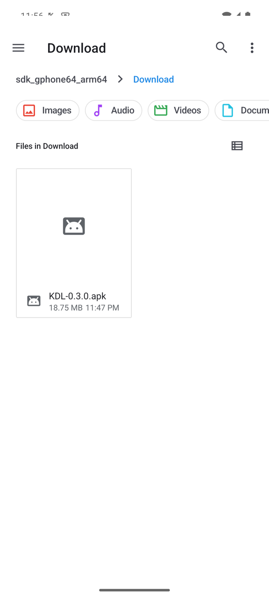 | 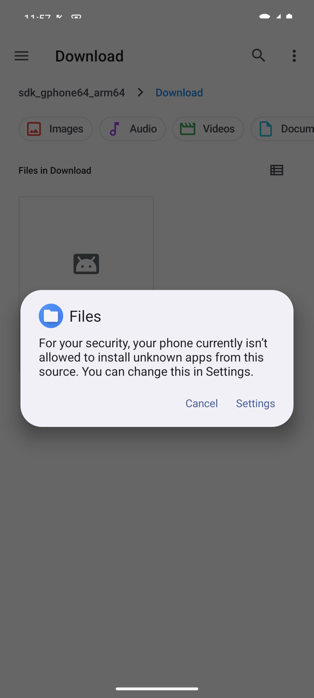 | 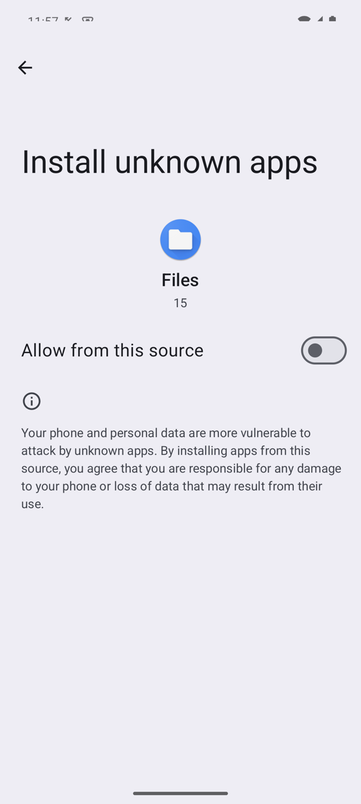 |

1. Tap the APK.
2. Android says the phone "isn't allowed to install unknown apps from this source". Tap
   **Settings**.
3. Turn on **Allow from this source** for Files, go back and install. Android warns that you are
   responsible for anything an unknown app does. That is the trade on a test phone. Turn the
   switch off again when you are done.

The emulator screenshots stop at step 3. The switch was left off there and KDL was installed with
`adb` instead.

**"App was denied access."** On the Pixel 7a with Android 17 (8 November 2026), after the same APK
was installed from the Files app, switching KDL's capture on in Accessibility made Android answer
"App was denied access". The fix that worked there:

1. Open Settings, Apps, KDL.
2. Tap the three-dot menu at the top right and choose **Allow restricted settings**. Android asks
   for the phone's PIN.
3. Go back to Accessibility and switch KDL on again.

The first-run **Turn on capture** step says the same thing under its **Open Accessibility
settings** button.

Once installed, the home screen shows the app as **KDL**. App info, Accessibility settings and
Android's dialogs use the full name, Known-data logger.

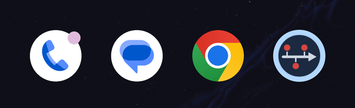

## 3. First run

The first time you open KDL it walks you through four steps. The bar at the top shows where you
are. **Next** stays grey until the step is done.

### Step 1: Get started

| Empty | Filled in |
|---|---|
| 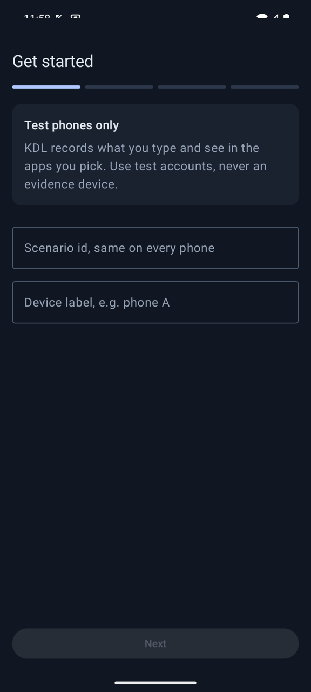 | 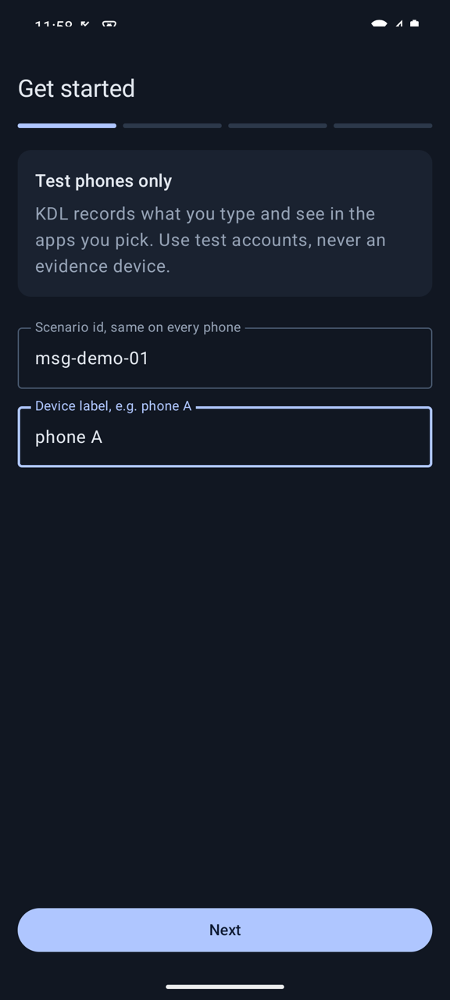 |

Read the notice, then fill in two fields:

- **Scenario id**: one name for the whole test. Use the same id on every phone in the test
  (`msg-demo-01` here).
- **Device label**: which phone this is (`phone A`).

Both go into every row of the log and into the export folder's name.

### Step 2: Pick apps

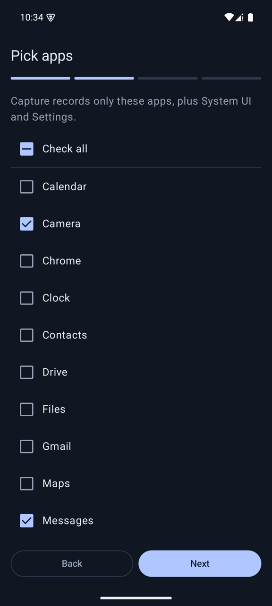

Tick the apps under test. The list shows apps with a launcher icon, without KDL itself. Capture
records only the apps you tick, plus System UI and Settings, which are always captured. **Check
all** at the top ticks every app in the list, and tapping it again clears them all. It shows a dash
when only some are ticked. You can change the list later in [Setup](#apps).

**Search** narrows the list by app name or package name. While a search is typed, the box reads
**Check all shown** and ticks or clears only the apps on screen. Apps you ticked before the search
stay ticked.

### Step 3: Turn on capture

| Waiting | Accessibility | Known-data logger | Allow | Capture is on |
|---|---|---|---|---|
| 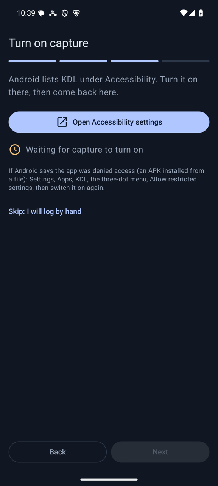 | 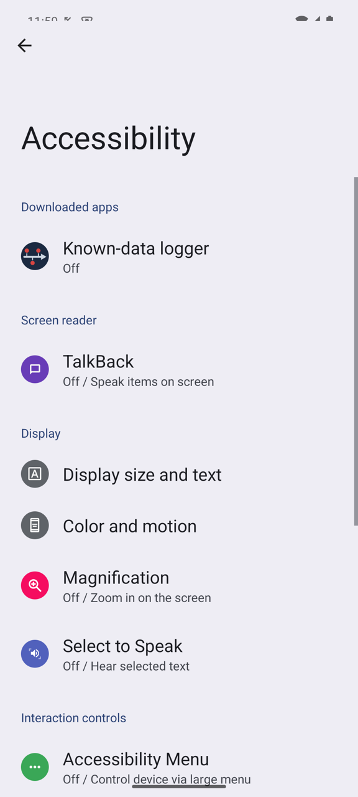 | 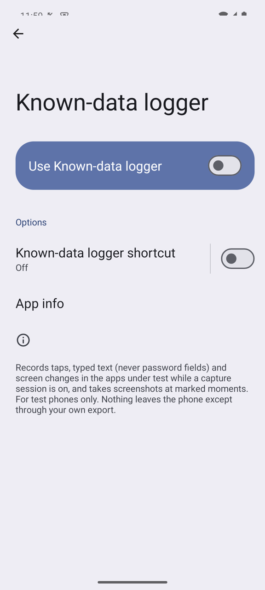 | 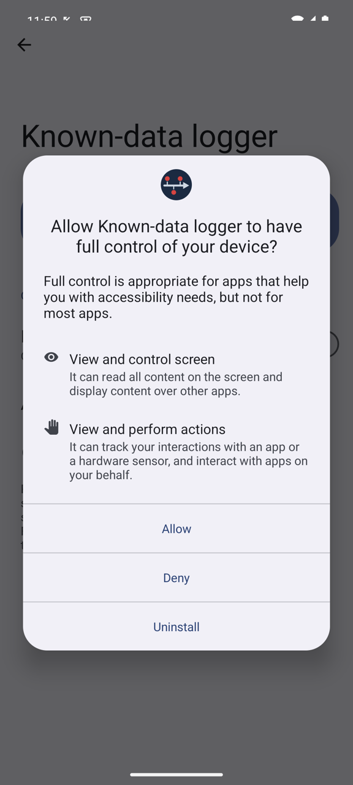 | 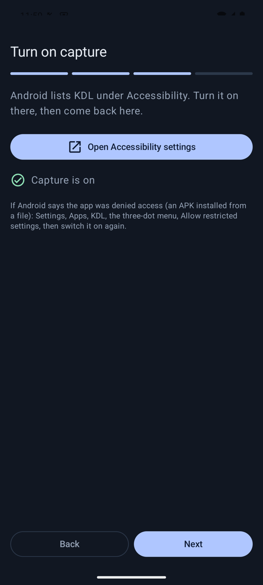 |

1. Tap **Open Accessibility settings**.
2. Under **Downloaded apps**, tap **Known-data logger**.
3. Switch on **Use Known-data logger**.
4. Android asks whether to allow full control of the device and lists what the service can do.
   Tap **Allow**. This is the permission capture runs on.
5. Go back to KDL. A green tick appears with the words **Capture is on**.

If you installed from a file and Android says the app was denied access, see
[Install from an APK file](#from-an-apk-file-on-the-phone).

If capture cannot be turned on for this phone, tap **Skip: I will log by hand**. KDL then records
only what you log yourself. See [Start without capture](#start-without-capture).

### Step 4: Ready

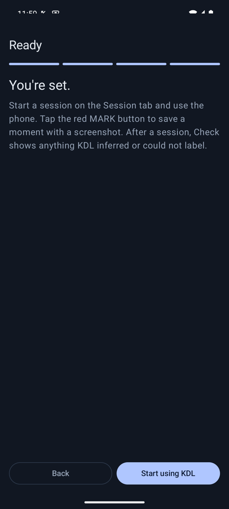

Tap **Start using KDL**. KDL takes the first device snapshot (make, model, Android version, build,
security patch, fingerprint, kernel, baseband) and opens the Session tab. If you skipped step 3, the
page says capture is off and that the Session tab offers **Start without capture**.

## 4. Record a session

KDL has three tabs: **Session**, **Check** and **Setup**.

| Ready to start | Recording |
|---|---|
| 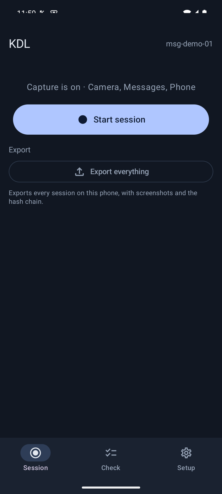 | 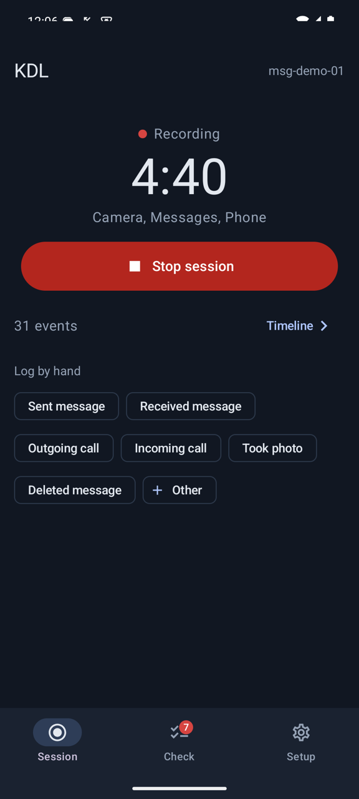 |

### Start

Tap **Start session**. If capture is off, the button reads **Open Accessibility settings**
instead, with **Start without capture** under it.

While a session runs, the Session tab shows:

- **Recording** and a timer since the start
- the apps under test
- **Stop session**
- how many events were captured, refreshed every few seconds, and a link to the **Timeline**
- **Log by hand** chips (below)

The Check tab's badge counts the items waiting for you.

Capture only runs between Start session and Stop session. Both moments are written to the log.

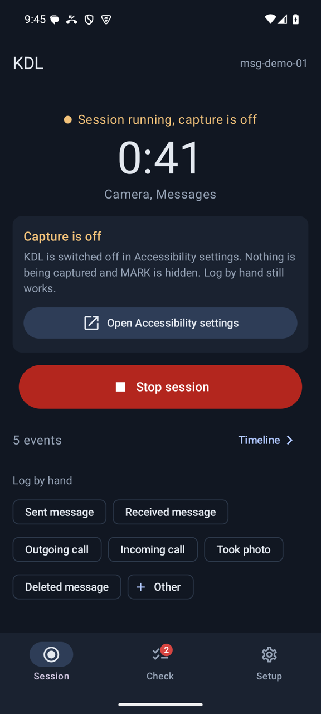

If KDL gets switched off in Accessibility settings while a session runs, the Session tab says so:
"Session running, capture is off", with a **Capture is off** card and a button to
**Open Accessibility settings**. Nothing is captured and MARK is hidden until you turn it back on.
Log by hand still works. KDL checks every few seconds, and when you come back to it.

### Start without capture

| Capture is off | Logging by hand |
|---|---|
| 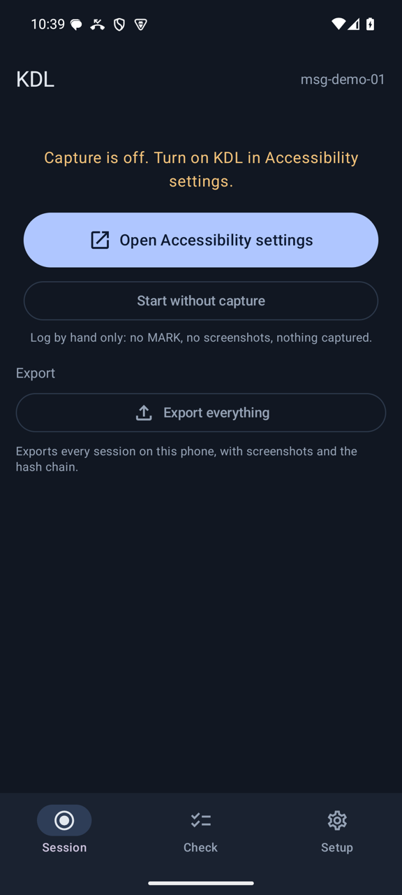 | 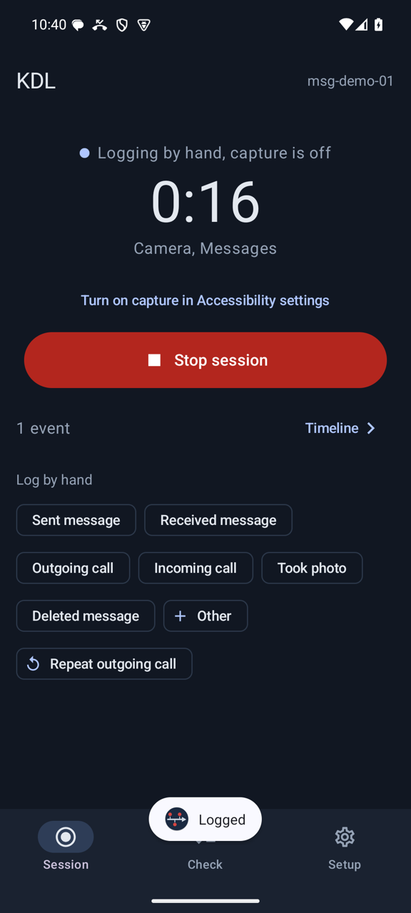 |

For a phone where the accessibility service cannot be switched on, **Start without capture** starts
a session for hand logging only. There is no MARK, there are no screenshots, and nothing is
captured or inferred. The **Log by hand** chips, the Timeline, the hash chain and the export work
as in any session. The session's start row ends with `capture=off`, so the log says how it was
recorded.

During such a session the Session tab reads "Logging by hand, capture is off", with a link to
Accessibility settings and no warning. If you turn capture on while it runs, KDL starts capturing
from that moment and MARK appears. On the Android 15 emulator (11 November 2026) the tab changed to
"Recording", the log got a **Capture resumed** row, and a send and a MARK after it were captured
with their screenshots. From then on the session is treated as a capture session: if capture is
lost again, the Session tab shows the **Capture is off** warning.

### What gets captured

In the apps under test, System UI and Settings, while the phone is unlocked:

- **screens**: the window title when the app changes screen
- **taps**: the label and view id of what you tapped
- **typed text**: the field's final value, stamped at your last keystroke. If the screen changes
  while you type (a suggestion list opens, for example), the text so far is written and the rest
  becomes a second row. In the demo, typing a phone number gave a row with `5` and then one with
  the full number.
- **a cleared field**: a field that went from text (at least two characters) to empty in one
  change. Apps built with Jetpack
  Compose (Google Messages, for example) report no tap on their Send button, so a cleared
  message field is how KDL sees a send.
  In builds after 0.5.0, a field that KDL holds typed text for and then finds empty, with no text
  change reported, is logged as a cleared field too. The row's detail ends with
  `no text change reported`. Apps built with Android views do this when they replace the field's
  text on a send: Android reports that as a content change and a selection change (`setText` in
  Android 15's `TextView`), not as a text change.
- **notifications** from the apps under test, with title (usually the sender) and text, even
  while the phone is locked
- **app changes** during the session: an app under test installed, updated, removed or with its
  data cleared, with versions. At session start, an app whose version differs from the last one
  the log accounted for is flagged once.

Password fields are never recorded. See [section 11](#11-what-kdl-does-not-do) for the rest of the
rules.

### MARK

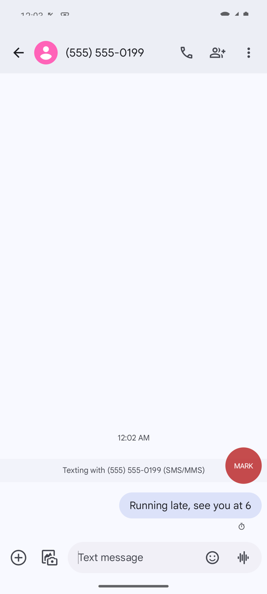

During a session a red **MARK** button floats over every app except KDL. Tap it at any moment you
want saved. KDL writes a mark row and takes a screenshot. The button hides itself for the
screenshot, so it is not in the picture. KDL asks the phone for a short buzz on the tap. Whether
you feel it depends on the phone's touch vibration setting. The buzz was not tried on a real
phone; the emulator has no vibration.

- The mark is filed under the last captured app whose screen changed. System UI does not count,
  so a mark tapped after pulling down the notification shade still lands on the app.
- Drag MARK up or down to move it out of the way. A short tap marks; a drag moves. KDL remembers
  where you left it.
- MARK hides while KDL is on screen, so it never covers KDL's own buttons.

Each mark waits on the Check tab until you say what it was.

### Log by hand

The chips under **Log by hand** are for what the screen cannot show: a call on another phone, a
photo with a camera app you did not pick, a SIM swap.

| A chip's sheet | More fields |
|---|---|
| 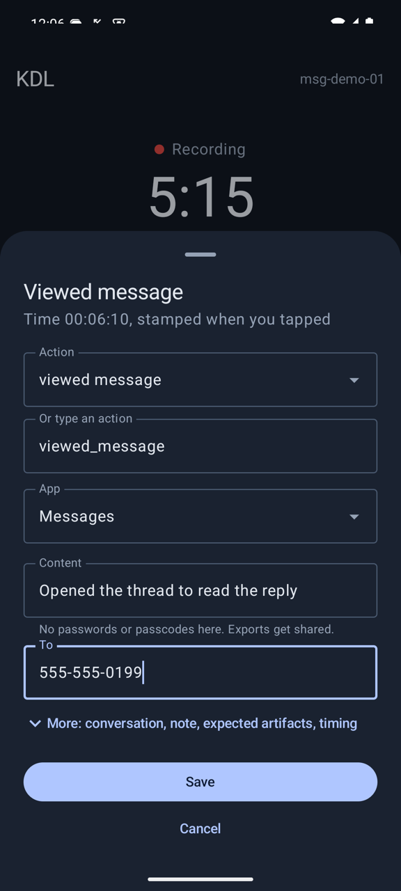 | 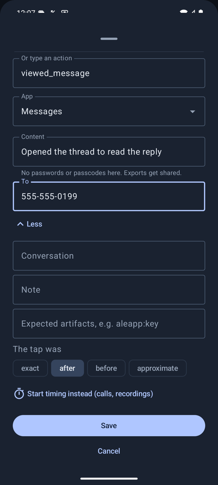 |

1. Tap a chip: **Sent message**, **Received message**, **Outgoing call**, **Incoming call**,
   **Took photo**, **Deleted message**, or **Other**. The time is taken when you tap the chip, not
   when you save. The sheet says so: "Time 00:06:10, stamped when you tapped".
2. **Other** opens an **Action** list of templates (messages, calls, media, browsing, contacts,
   accounts, apps, radios, clock and power changes, SIM, factory reset). You can also type your
   own action in **Or type an action**.
3. Pick the **App**, or **No app (device)**. The sheet starts on the app under test that was last
   on screen in this session. If none was, it starts on the app of your last hand entry, and
   otherwise on the first app in the list.
4. Fill in **Content** (the exact text sent, a file name, a caption) and **To** or **From**. The
   label follows the action: received message, incoming call, missed call and received media are
   incoming ("From"). Every other action, a typed one included, is written with direction `out`
   ("To"), even one with no real direction, like `viewed_message`. Before an action is picked the
   field reads "To or from".
5. **More** opens **Conversation**, **Note**, **Expected artifacts** and **The tap was**:
   - Expected artifacts take `core:artifact_key` values (the field's hint says `aleapp:key`),
     separated by commas or spaces.
   - **The tap was** says how the tap relates to the act: **exact**, **after**, **before** or
     **approximate**. The export carries the matching checker tolerance: 120 seconds for exact,
     300 for before and after, 900 for approximate. These are chosen defaults, not measured ones.
   - **Start timing instead (calls, recordings)** starts a timer. A card on the Session tab then
     reads "Timing since ..." with a **Done** button. Done opens the sheet again ("From ... to
     now"). Save writes one entry, stamped at the start, with the window's length in seconds.
6. Tap **Save**.

After a save, a **Repeat** chip logs the same action again with a new time. Logging a
**factory reset** shows a warning first: a reset erases the log, so export and copy it off the
phone before you reset.

The chips show only while a session is running.

### Stop

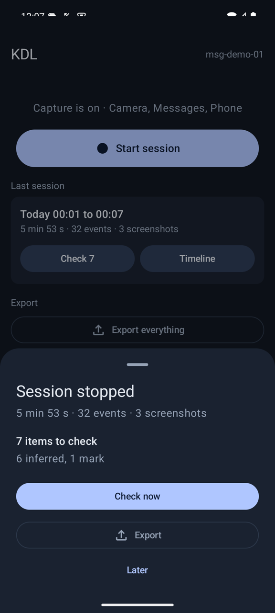

Tap **Stop session**. A sheet shows how long the session ran, how many events and screenshots it
produced, and how many items need checking, split into inferred actions, marks, locked
notifications and entries without an action. If some came from earlier sessions, it says how
many. Then choose **Check now**, **Export** or **Later**.

In the demo session above (5 min 53 s), KDL captured 32 events and 3 screenshots and left
7 items to check: 6 inferred actions and 1 mark.

## 5. Check what was captured

The Check tab has two views: **To check** and **Timeline**.

### To check

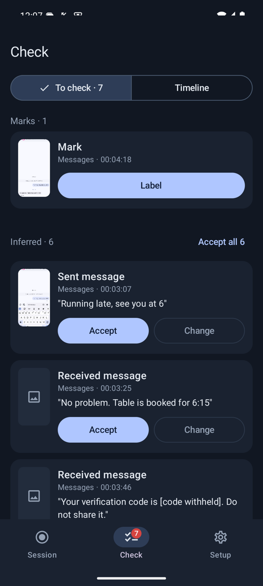

Items that only a person can answer come first:

- **Marks**: tap **Label** and say what the moment was.
- **Locked notifications**: see below. Tap **Label**.
- **No action yet**: an entry with a time but no action. Tap **Describe**.
- **Inferred**: actions KDL worked out on its own. These come last because there are often many.
  The first three show, with **Show N more inferred** under them.

When nothing is left, the view says "Nothing to check."

### Label a mark

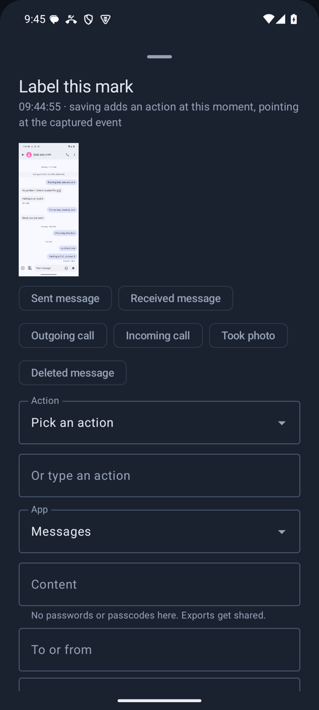

The sheet shows the mark's screenshot and its time. Under the screenshot, **Text on this screen**
lists the text that was on the screen when you tapped MARK, top to bottom, from the view tree KDL
saved with the screenshot (see [View tree](#view-tree)):

- Tap a line to use it as **Content**.
- Press and hold a line to use it as the counterpart (**To**, **From** or **To or from**).
- The first six lines show at first. **Show all** lists the rest, **Show fewer** shortens it again.
  The first lines are often the app's own title, buttons and banners; the messages come after them.
- Nothing is filled in without a tap, and you can still type or change what a tap filled in.

| All the lines | Content and From filled from the lines |
|---|---|
| 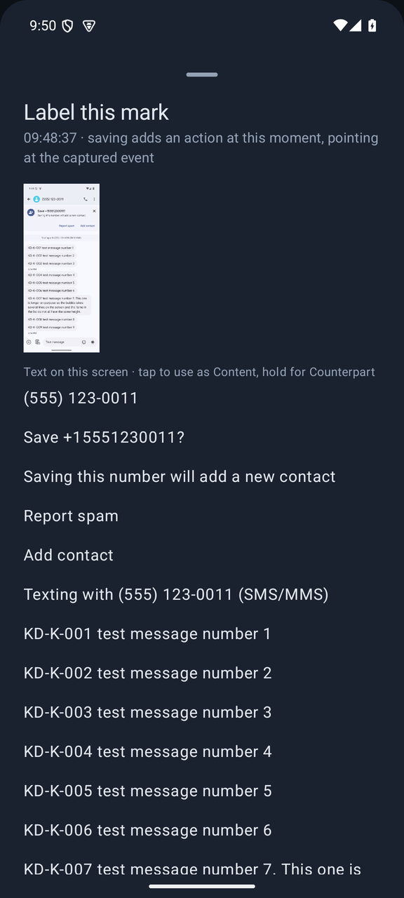 | 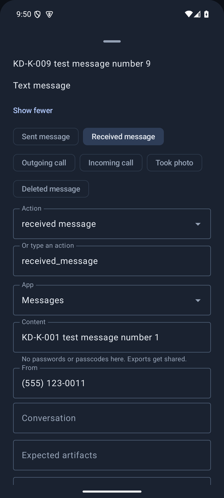 |

The list is there when a view tree was saved: the setting is on, the app was one of yours, and the
phone was unlocked. A mark from before 0.5.0 has none. An app that reports little in its view tree
gives a short list or none.

Tap one of the chips for the common actions
(the same six as on the Session tab), or pick or type the action, and fill in what you know.
**App** starts on the app the mark was filed under; change it if the mark landed on the wrong one.
**Save label** adds an action at the mark's time that points back at the mark.
**Discard mark** removes the mark (it is kept as a tombstone, see
[section 6](#edit-revise-remove)).

### Inferred actions

An inferred action is a guess until someone accepts it.

- **Accept** takes it as it is.
- **Change** opens **Check this entry**, which says which rule inferred it. Fix what is wrong and
  tap **Save with changes**, or tap **Accept as is**.
- **Accept all N** accepts every inferred action at once.

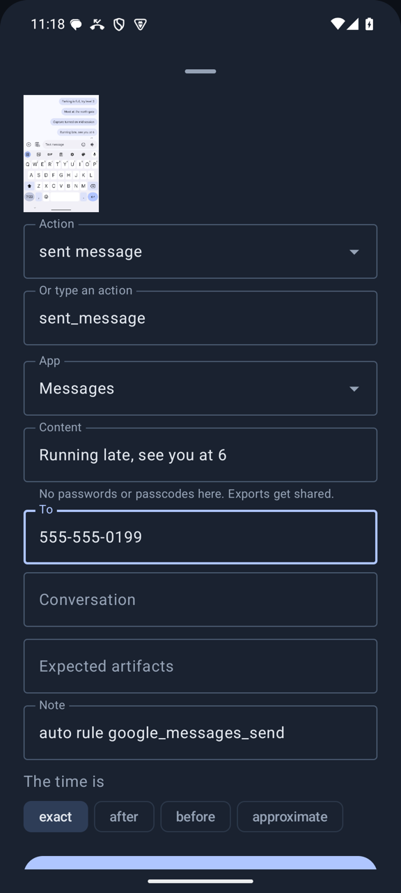

In the demo, the send rule knew the text of the message but not who it went to. Rules do not fill
in the counterpart, so it was added with **Change**. In 0.3.0, actions inferred by a rule also leave
the direction empty, and the edit sheet has no direction field. From 0.3.1, KDL writes `out` for
them, as it does for a hand-logged send.

| Accept all, with Undo | After Undo |
|---|---|
| 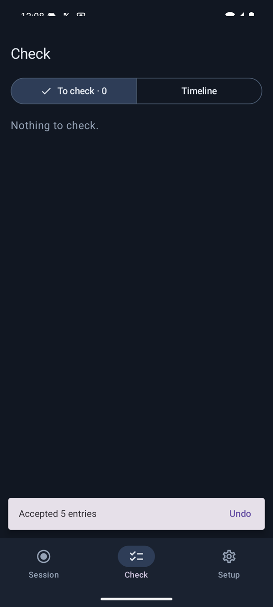 | 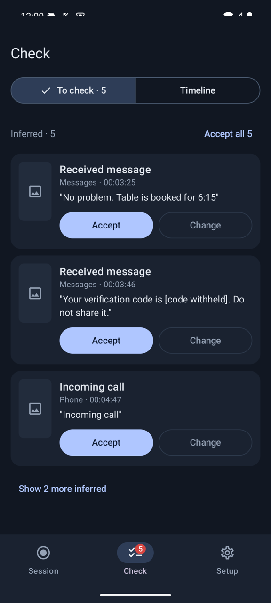 |

After **Accept all**, a bar at the bottom reads "Accepted 5 entries" with **Undo** for about ten
seconds. After that, change an entry from the Timeline. Undo puts all
of them back on the list. Nothing is overwritten either way: accepting and undoing both add a new
revision of the entry.

The code in the second received message reads `[code withheld]`. That is the
[Hide verification codes](#hide-verification-codes) option at work.

### Where inferred actions come from

- **Rules** (see [Rules](#rules)). The app ships two:
  - Google Messages: the message field cleared in one change becomes `sent_message`, with the
    text that was in the field as its content. Checked against Messages
    `messages.android_20240528_00_RC01` on an Android 15 emulator.
  - AOSP Camera: a tap on the shutter button becomes `took_photo`. Checked against Camera 2.0.002
    on an Android 15 emulator.

  The shipped rules are in `app/src/main/assets/rules/` in the repository.
- **Notifications** from the apps under test, by the category the app gave the notification:
  - a message notification becomes `received_message`
  - a missed-call notification becomes `missed_call`
  - a call notification becomes `incoming_call` only when the app marks it as an incoming call
    (Android 12 and later), because dialers post ongoing calls in the same category

This was tried on an Android 15 emulator (8 November 2026) with an SMS and a call sent from the
emulator console.

Notifications in any other category (for example "Messages is doing work in the background") are
kept as raw events and show up on the Captured events sheet, but no action is inferred from them.

When **Screenshot inferred actions** is on, a rule match also takes a screenshot. Actions inferred
from notifications have no screenshot.

### Locked notifications

On Android 17 (seen on a Pixel 7a, 8 November 2026), a notification that arrives while the phone is locked reaches
KDL without its details: no sender, no text, no category, only a short line such as
"New message.". KDL keeps it with that line, notes "notification details withheld by Android while
locked", and puts it under **Locked notifications** for you to label. It cannot infer anything from
it.

The Android 15 emulator did not do this. A text sent to it while it was locked (no PIN set)
arrived with its sender and text and became a normal `received_message`. So there is no
screenshot of this section here.

### Timeline

| Timeline | With captured events |
|---|---|
| 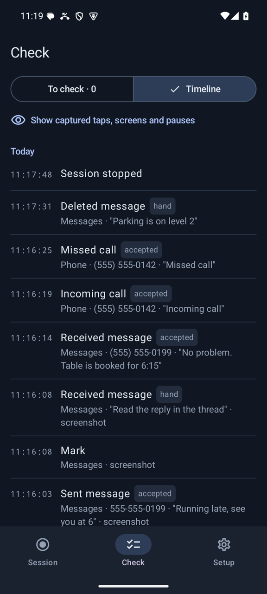 | 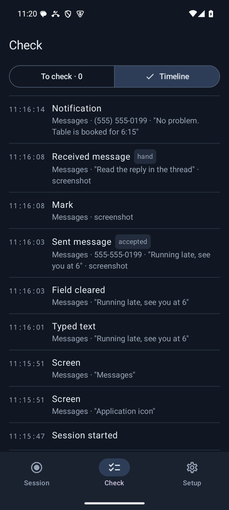 |

The Timeline lists every current entry, newest first, with the time to the second. The time shown
is local to the time zone recorded with the entry. Tags after the action say where it came from:

- **hand**: logged by hand or labelled from a mark
- **inferred**: worked out by KDL, not yet accepted
- **accepted**: worked out by KDL and accepted by a person
- **locked**: a locked notification

The grey line under each entry shows the app, the counterpart, the content, **edited** if a
hand-logged entry has been revised (accepted or changed inferred entries do not show it), and
**screenshot** if it has one.

**Show captured taps, screens and pauses** adds the raw events: every screen, tap, typed value,
cleared field, notification, and each time the capture service paused and came back. Tap any row
to edit or label it.

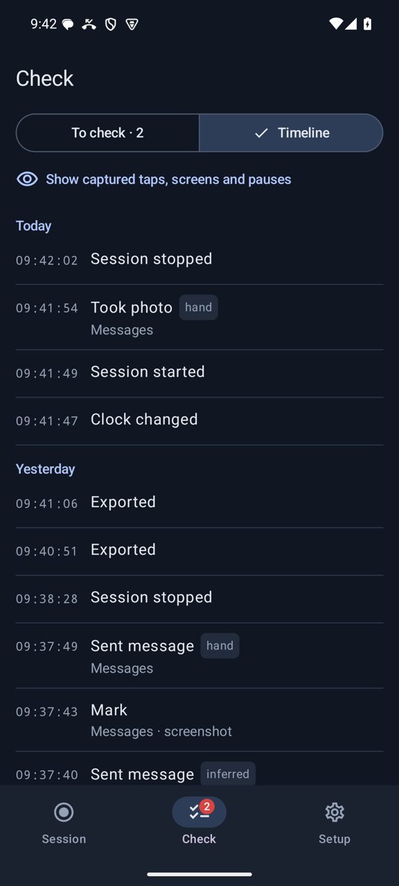

Each day starts under its own header: **Today**, **Yesterday**, or the date. On the To check
cards, an item from another day shows the day in front of its time. For this picture the
emulator's clock was moved one day ahead, which is the **Clock changed** row. The Timeline is
ordered by the phone's time since boot, so after the clock is set back a day's header can show
twice.

## 6. Edit entries and teach rules

### Edit, revise, remove

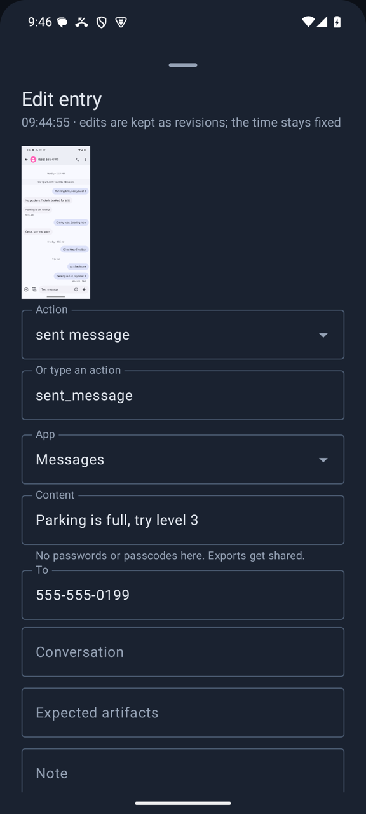

Tap an entry in the Timeline. The sheet says it plainly: "edits are kept as revisions; the time
stays fixed".

- **Save revision** writes a new revision. The original stays in the log, and the action time
  never changes.
- **App** can be changed, so an entry logged under the wrong app is fixed here and keeps its time.
  The revision takes the new app's version as installed when you save.
- The counterpart field reads **To** or **From**, as it does when logging by hand. If you change
  the action, the direction follows it: an entry changed from sent to received is written `in`.
- **I deleted this, log the deletion** is for a test step where you deleted the thing in the app.
  It logs a new `deleted_item` action at the current time that points at this entry.
- **Remove entry** takes the entry off the Timeline. The log keeps it and adds a tombstone
  revision that says it was removed.

KDL's own rows (session start and stop, device snapshots) open the same sheet. Nothing stops you
from revising them, so leave them alone.

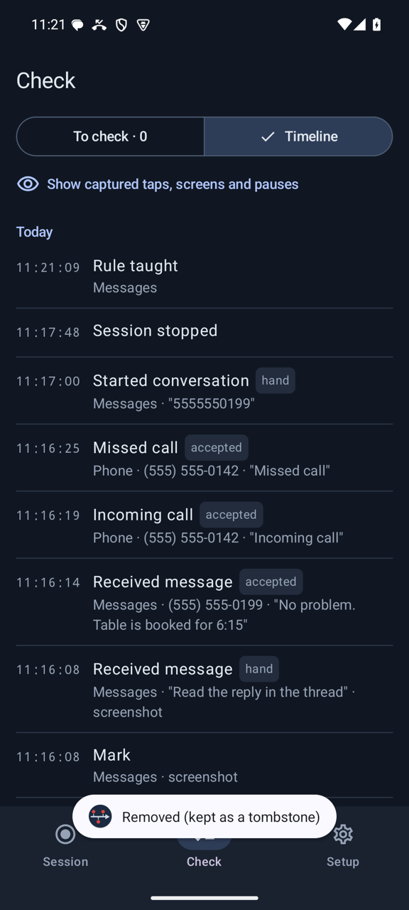

### Teach a rule

When KDL does not know an app, you can teach it from something it captured.

| Make a rule | Rule saved |
|---|---|
| 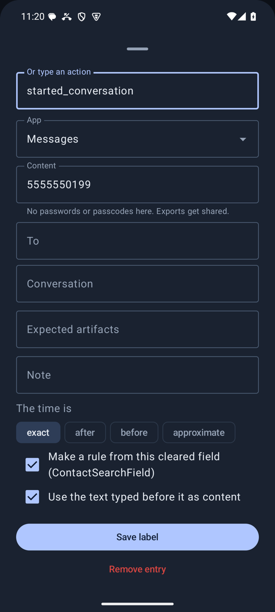 | 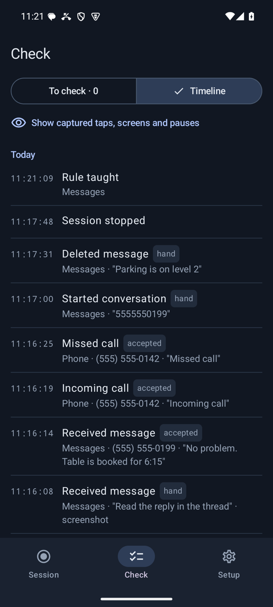 |

1. In the Timeline, tap **Show captured taps, screens and pauses**.
2. Tap a captured **Tap** or **Field cleared** row. You can also start from a mark: KDL looks for
   the newest tap or cleared field in the same app, in the same boot, up to 30 seconds before the
   mark.
3. Type or pick the action.
4. Tick **Make a rule from this tap** or **Make a rule from this cleared field**. The view id it
   will match is shown in parentheses. For a tap with no view id, the tap's label is shown in quotes.
5. **Use the text typed before it as content** appears once the rule box is ticked. It starts
   ticked for a cleared field (the content is the text that was cleared) and unticked for a tap
   (ticked, the content is the text typed just before the tap).
6. Tap **Save label**. KDL says "Rule saved" and a **Rule taught** row goes into the log.

In the demo, the Messages "To" field (`ContactSearchField`) clearing after a number was typed was
labelled `started_conversation`, and a rule was made from it. From then on, that event in that
app is inferred as `started_conversation`. A rule works on what is captured after it is saved. It
does not relabel older events.

Things to know:

- A tap with no view id is matched on its whole label, ignoring case. That label is stored in the
  rule. Check taught rules before you share them.
- A cleared field can only be taught when it has a view id, because its label would be the
  message you typed.
- Taught rules are saved in `rules.json` in the app's files folder,
  `Android/data/com.abrignoni.knowndatalogger/files/`. Share them with **Export rules** and load
  someone else's with **Import rules**, both in [Setup, Rules](#rules). `adb pull` and `adb push`
  on that file still work. A rule in that file overrides a built-in rule with the same id.
- Each taught rule records the device label, model, app version and time it was taught.
- If `rules.json` holds a rule KDL cannot read, saving the rule refuses and leaves the file as it
  is. The label itself is still saved.

## 7. Setup

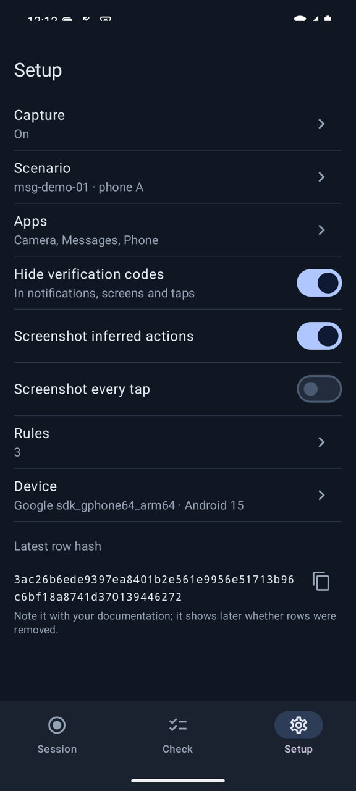

### Capture

Shows **On** or **Off**. Tap it to open Accessibility settings.

### Scenario

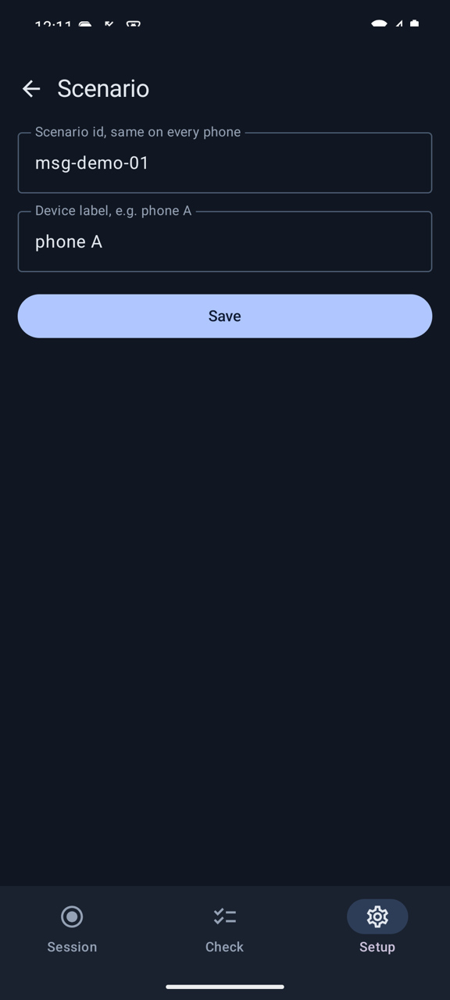

Change the scenario id or the device label. Tap **Save**. New rows carry the new values.

### Apps

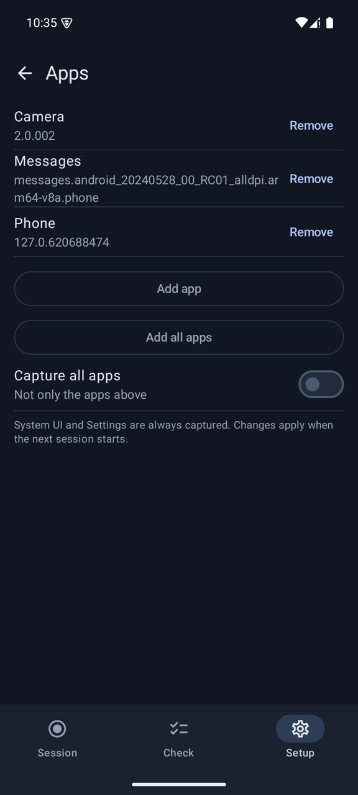

The apps under test, with the version each had when it was added. **Remove** takes one off.
**Add app** opens a list of launcher apps with a **Search** box. Pick one, and fill in an
**Account handle** if the test uses an account (optional). No passwords here. **Add all apps** adds every launcher app that is not
in the list yet, without account handles. Apps already in the list keep theirs. Apps installed
later are not added; tap it again or use **Add app**.

**Capture all apps** records every app, not only the ones in the list. System UI and Settings are
always captured. The difference from **Add all apps**: only the apps in the list go into the
export's list of apps under test, with their versions when added and at export, and only they are
checked for a version change at session start.

At session start, KDL compares each app's version with the last version it logged. If it changed,
an `app_version_changed_since_last_seen` row says so, once.

### Hide verification codes

On by default. In notifications, screen titles and tap labels, a run of 4 to 8 digits in text that
mentions a code, OTP, passcode, PIN, verification, verify, 2FA or one-time is replaced with
`[code withheld]`. A notification that had a code withheld says so in its detail.

On the emulator, an SMS code was absent from the database file and from the live copy afterwards.

It does not touch typed text, and codes in other wording are not caught. Keep real accounts off
test phones.

### Screenshots

- **Screenshot inferred actions** (on by default): a screenshot each time a rule infers an action.
- **Screenshot every tap** (off by default): a screenshot for every captured tap that no rule
  matched.
- A MARK always takes a screenshot.

Screenshots use the accessibility service's own capture (Android 11 and later). No extra
permission and no prompt appeared on the emulator. Each one is saved in the app's private folder
with a SHA-256 taken at capture. An app that blocks screenshots gives a black frame, which is
recorded as `blank`. Other values in the screenshot status are `ok`, `pending` (capture started and
never finished), `unsupported` (Android 10 and earlier) and `failed:` with the reason.

While a session runs, Setup reminds you that changes to these switches and to the app list apply
when the next session starts.

### View tree

- **Save the view tree with screenshots** (on by default): with each screenshot, KDL also saves the
  view tree of the app in front, as an `.xml` file. The view tree is what the app reports is on the
  screen: each piece of text, its place on the screen and its type. It gives the exact text of a
  screen without reading it off the picture.
- What was typed into a password field is left out: that field is listed with empty text. Every
  other text is saved as shown, including a message that mentions a password or carries a code.
  "Hide verification codes" does not apply to view trees.
- A tree is saved only for an app that is being captured. System UI is never saved, because its
  tree holds the whole notification shade, and nothing is saved while the phone is locked. The
  status then reads `not_captured:` with the reason.
- The tree is what the app reports, not what a person saw. An app can report more than the screen
  shows, less, or nothing.
- After each capture KDL writes a `capture_files` row with the SHA-256 of the screenshot and of the
  view tree. That row is in the hash chain, so the chain covers both files.

What KDL does with a saved view tree:

- **When you label a mark or a captured event**, the form lists the text that was on that screen,
  top to bottom, under the screenshot. Tap a line to use it as Content. Press and hold a line to use
  it as the counterpart. Nothing is filled in without a tap, and you can still type. The first lines
  are often the app's own buttons and banners; "Show all" lists the rest.
- **In the spreadsheet**, a Screen text sheet lists every line of every saved tree in screen order,
  with the entry it belongs to and links to the screenshot and the tree file.
- **In `kdl_locate.py`**, a Screen text sheet lists the lines that were on a marked screen and that
  you did not log, and says whether each was found in one of the app's stores and where. Lines under
  4 characters are left out, and at most 400 lines are searched.

Tried on an Android 15 emulator (11 November 2026) with Google Messages and Settings: a message
holding the words "PIN" and "password" and one holding a verification code were in the saved tree
as shown, and digits typed into the Settings confirm-PIN field were not. The export passed
`make_documentation.py`. On the label form, a tap filled Content with a three-line message exactly,
and a hold filled the counterpart with the thread's number.

### Rules

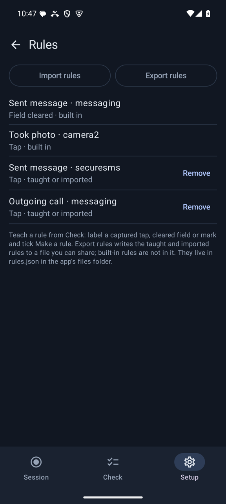

Every rule in effect: the action, the app, whether it matches a **Tap** or a **Field cleared**,
and whether it is **built in** or **taught or imported**. Taught and imported rules have
**Remove**.

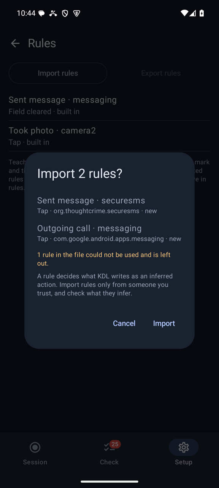

- **Export rules** writes the taught and imported rules to a file, `kdl-rules.json` unless you
  rename it, in the folder you pick. Built-in rules are not in it. The button is grey when there
  are none to export.
- **Import rules** opens Android's file picker. Pick a rules file and KDL lists what is in it:
  each rule's action, app and event, and whether it is **new** or **replaces a rule in effect**
  (a rule with the same id, built in or not). A rule KDL cannot use is counted and left out: one
  with no id, package or action, an event other than tap or field cleared, no view id and no label
  pattern, a label pattern that does not compile, or content other than the typed text. Tap
  **Import** to add them. The import is logged as a **Rules imported** row with the file name and
  the rule ids.
- A rule decides what KDL writes as an inferred action, so import rules only from someone you
  trust. Inferred actions still wait in Check until you accept them.

### Device

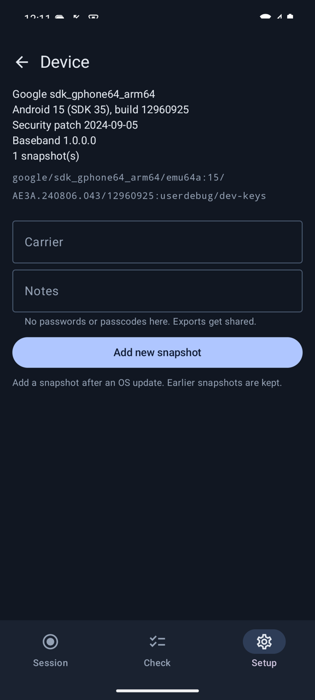

The latest device snapshot. Add the **Carrier** and **Notes** if you want them, then
**Add new snapshot**. Take a new snapshot after an OS update. Earlier snapshots are kept, and each
one is logged.

### Start over

| Start over | The new log |
|---|---|
| 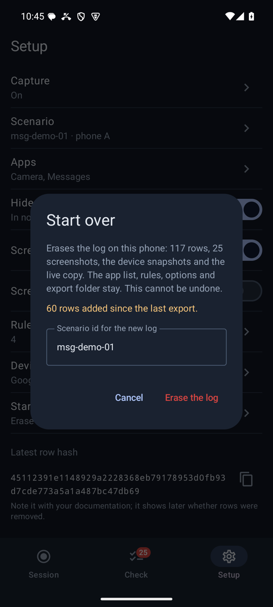 | 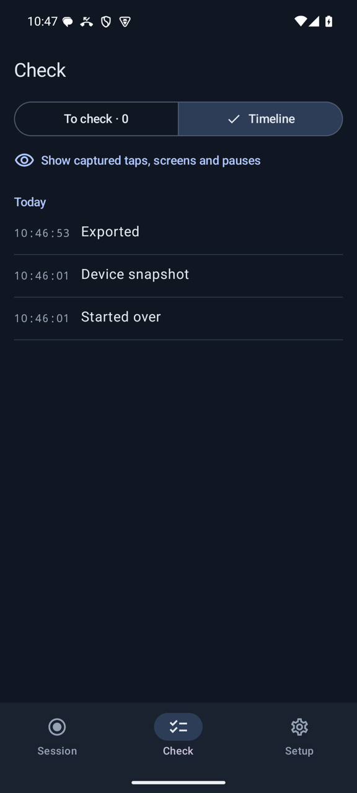 |

**Start over** erases the log and begins a new one. While a session runs or an export is in
progress, tapping it only says to stop the session or wait.

- It erases every row, the screenshots, the device snapshots and the live copy
  (`actions-live.jsonl`). The dialog says how many rows and screenshots that is.
- It keeps the app list, the rules, the options and the export folder.
- It tells you what was not exported: "This log was never exported", or how many rows were added
  since the last export that finished. Export first if you need them.
- **Scenario id for the new log** starts as the current one. Change it for a new scenario.
- The new log opens with a **Started over** row, then a fresh device snapshot. The hash chain
  starts again at that row, so a hash you noted before belongs to the erased log.

On the Android 15 emulator (11 November 2026), after a Start over the database held only the new
rows, the screenshots folder was empty, `rules.json` and the app list were as before, the text of
an earlier message was no longer in the database file, and `make_documentation.py` reported the
new export's hash chain as intact. Start over does not delete exports already in your export
folder.

To remove everything, rules and settings included, use Android's Clear storage. See
[I want to start over](#i-want-to-start-over).

### Latest row hash

The hash of the newest row in the log, with a copy button. Write it in your documentation. See
[section 10](#10-the-hash-chain).

## 8. Export

| Pick a folder | Allow access | Exported |
|---|---|---|
| 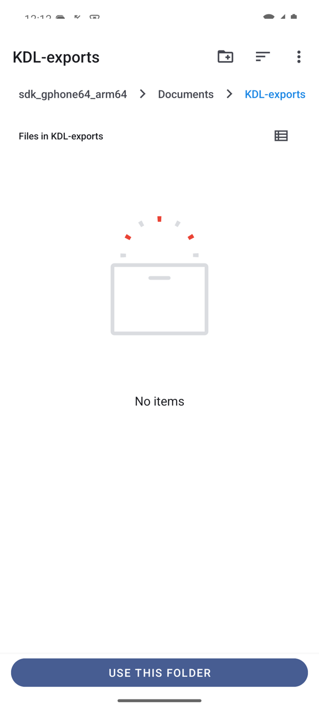 | 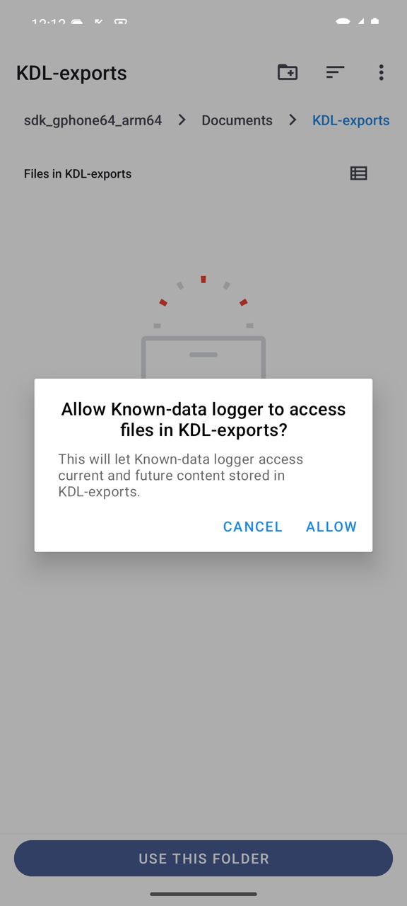 | 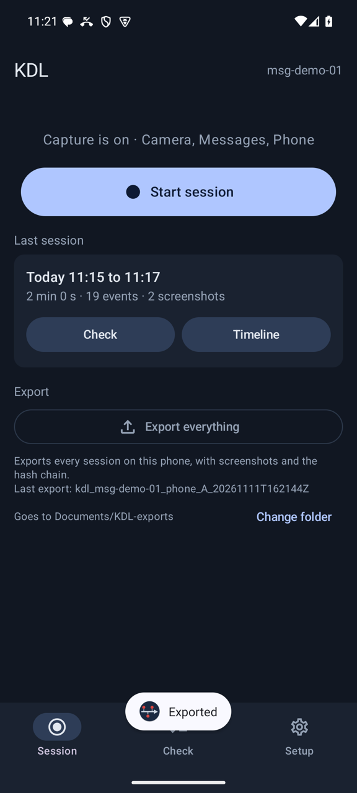 |

1. On the Session tab, tap **Export everything** (or **Export** on the sheet after you stop a
   session).
2. Android's folder picker opens. Pick a folder or make a new one, then tap **Use this folder**.
3. Android asks whether KDL may access files in that folder. Tap **Allow**.
4. While it runs, a progress bar replaces the button and counts the files: "Exporting: 14 of 28
   files". The files are the screenshots, the view trees and the three log files.
5. KDL says "Exported" and shows the folder name under the button.

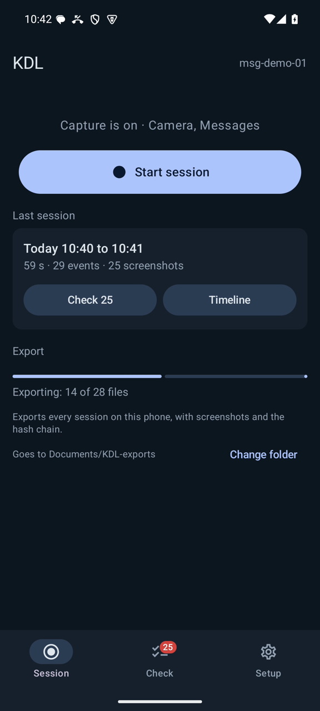

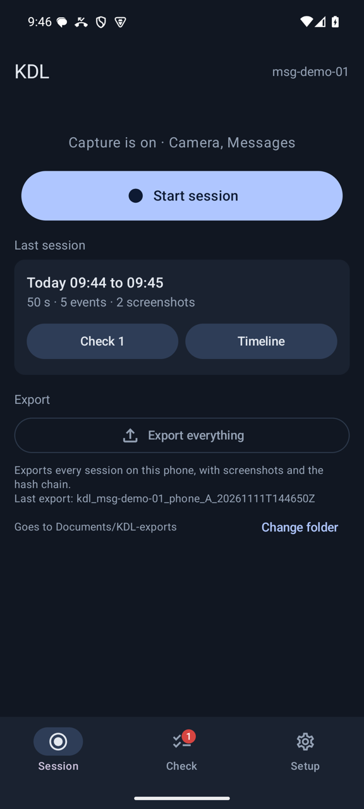

KDL remembers the folder. The next export goes straight into it, with no picker, and the Session
tab shows where: "Goes to Documents/KDL-exports". **Change folder** opens the picker again. If the
folder is gone, the next export opens the picker.

The export holds every session on the phone, with every revision of every entry. KDL writes the
export as a row in the log first, so the export lists itself.

The folder is named `kdl_<scenario>_<device>_<UTC time>`, for example
`kdl_msg-demo-01_phone_A_20261109T051237Z`. Spaces and other characters outside letters, digits,
dots, dashes and underscores become `_`. Inside:

| File | What it is |
|---|---|
| `manifest.json` | Device snapshots, apps under test (version when added and at export), the rules in effect, checker tolerances, the export time, the SHA-256 of `actions.jsonl`, the end of the hash chain, and every screenshot and view tree with its hash at capture and at export |
| `actions.jsonl` | Every row, every revision, one JSON object per line |
| `actions.csv` | The same rows for a spreadsheet, columns in reading order: time, what happened (action, app, content, counterpart), status (current, reviewed, source), screenshot, context, then clock internals and identifiers. Filter `is_current` to TRUE for the latest version of each entry |
| `screens/` | The screenshots |
| `trees/` | The view trees, one `.xml` file per screenshot that has one (0.5.0 and later) |

**Export everything** shows only when no session is running. Stop the session first.

On a phone where KDL runs in a second user profile, the shell could not list that profile's
storage on the Pixel 7a (8 November 2026). This manual does not describe a way around that.

Copy the export off the phone with `adb pull`. The demo export went to `Documents/KDL-exports`:

```bash
adb pull /sdcard/Documents/KDL-exports/kdl_msg-demo-01_phone_A_20261109T051237Z
```

In `actions.jsonl` the original row of an entry carries `screenshot` and `view_tree`, each with the
file name, its SHA-256 and a status; `actions.csv` has the same in `view_tree_file`,
`view_tree_status` and `view_tree_sha256`. After each capture there is also a `capture_files` row
whose detail names the entry and the SHA-256 of both files. That row is in the hash chain, so the
chain covers the screenshots and view trees (see [section 10](#10-the-hash-chain)). On the Timeline it shows
only with **Show captured taps, screens and pauses**.

Field definitions are in [SPEC.md](SPEC.md) and the database layout in
[DATABASE.md](DATABASE.md).

## 9. Make the spreadsheet

`tools/make_documentation.py` reads one or more exports and writes an `.xlsx`. Give it every
phone's export for the same scenario:

```bash
python3 tools/make_documentation.py kdl_msg-demo-01_phone_A_20261109T051237Z -o documentation.xlsx
```

On the demo export it printed:

```
Wrote documentation.xlsx: 8 actions, 0 to review, 25 captured events
Sheets: Scenario, Apps, Camera, Messages, Phone, Capture pauses, Needs review, Captured events
```

For two phones, list both folders: `... kdl_..._phone_A_... kdl_..._phone_B_... -o documentation.xlsx`.
The Scenario sheet warns when the exports come from different scenario ids.

The images below are the demo workbook's cells, drawn as a grid so they fit on a page. The wide
sheets show their first columns only.

### Scenario

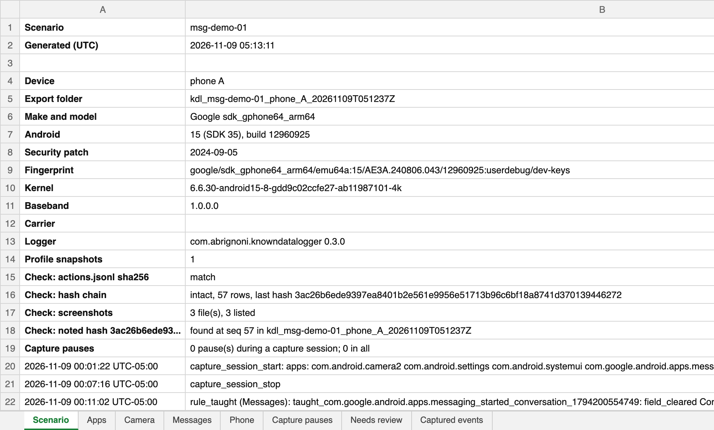

The scenario id, then for each device: the export folder, the device snapshot, the logger version,
and the checks:

- **actions.jsonl sha256**: does the file match the hash in the manifest
- **hash chain**: intact, or where it breaks
- **screenshots**: how many files there are and whether each still matches its hash from capture
- **view trees**: the same for the view trees (0.5.0 and later exports)
- **files against chained rows**: each screenshot and view tree checked against the hash in its
  `capture_files` row. A file swapped together with its hash in the manifest passes the line above
  and fails this one, because the manifest is not in the chain and the row is
- **noted hash**: only when you pass `--expect-hash` (see [section 10](#10-the-hash-chain))
- **Capture pauses**: how many times the capture service paused during a session, and for how long

After the checks come dated lines for session starts and stops, detected reboots and clock or time
zone changes, failed exports, apps installed, updated or removed during a session, taught and
removed rules, and a hash-chain backfill.

### One sheet per app


Each app with at least one action gets a sheet with its actions, in the order they happened: device, date, time,
UTC offset, action, content, counterpart, direction, conversation, time quality, window, source,
reviewed, a link to the screenshot, and the entry id. Actions logged with **No app (device)** go on
a **Device and system** sheet.

- A label made from a mark links the mark's screenshot.
- Rows are grouped by device and kept in each device's own order (boot count, then time since
  boot), which stays right when the clock is changed as a test step.
- Times are local, with the UTC offset in its own column.
- Every text value is written as text, so content such as `=1+1` is never run as a formula.
- Screenshot links are relative to the spreadsheet. Keep the spreadsheet beside the export
  folders, or the links break.

### Apps, Capture pauses, Needs review, Captured events


- **Apps**: each app under test, its package, version when added and at export, first install
  time and account.
- **Capture pauses**: each pause of the capture service, with start, end and length, and whether a
  session was running. A pause during a session can hide actions.
- **Needs review**: anything still waiting on the Check tab when you exported, and why.
- **Captured events**: every raw event (screens, taps, typed text, cleared fields, notifications,
  marks) with its screenshot link.
- **Screen text** (0.5.0 and later exports): every line of every saved view tree, in the order of
  the screen, with the entry it belongs to (a mark shows the action you labelled it with), the
  app's own description of the line when it has one, its place on the screen, and links to the
  screenshot and the view tree file. It gives the exact text of each marked screen without reading
  it off the picture.

In the 0.3.0 script some rows reach no sheet at all: the export rows, device snapshots, and the
`app_version_changed_since_last_seen` and `app_data_cleared` rows. Its Scenario list looks for a
different name for the version row and does not list the others. They are in `actions.csv` and
`actions.jsonl`. The script from 0.3.1 on lists all of them on the Scenario sheet.

## 10. The hash chain

Every row in the log carries two hashes:

- `prev_hash`: the previous row's hash (empty for the first row)
- `row_hash`: SHA-256 over the row's fields plus `prev_hash`

Change one character in a row or remove a row, and the chain breaks at that row. From 0.5.0 the
chain also covers the screenshots and view trees: each capture adds a `capture_files` row holding
the SHA-256 of both files, so a changed file no longer matches a hashed row.
`make_documentation.py` checks the whole chain on every run, and the app writes its own check into
the manifest at export. If the two disagree, the Scenario sheet says so.

Rows written before 0.3 are hashed the first time the upgraded app writes a row or opens the Setup
tab, and a `hash_chain_backfilled` row says so.

There is one thing the chain cannot catch on its own. Someone who cuts rows off the end and then
rewrites the manifest to match leaves an intact chain behind. That is what the **Latest row hash**
on the Setup tab is for.

### Note the hash

1. Export.
2. Open Setup. Right after the export, **Latest row hash** is the hash of the export's own row,
   the last row in the export. Any later row changes it (the capture service writes a row each
   time it disconnects or reconnects, session or not). The copy that counts is
   `hash_chain.last_row_hash` in the export's `manifest.json`. Check that the two match.
3. Copy it (the button beside it) and write it in your documentation, somewhere other than the
   export.

In the demo, the Setup tab, the manifest and the last line of `actions.jsonl` all showed
`3ac26b6ede9397ea8401b2e561e9956e51713b96c6bf18a8741d370139446272`.

### Check it later

```bash
python3 tools/make_documentation.py kdl_msg-demo-01_phone_A_20261109T051237Z \
  -o documentation.xlsx \
  --expect-hash 3ac26b6ede9397ea8401b2e561e9956e51713b96c6bf18a8741d370139446272
```

The Scenario sheet gets a **noted hash** line: "found at seq 57 in ..." when the row is still in
the chain. You can pass `--expect-hash` more than once.

### What tampering looks like

Two copies of the demo export were changed on purpose.

**One character changed** ("see you at 6" to "see you at 7" in one row). The script printed two
warnings (hashes shortened here), and the Scenario sheet says the same:


```
WARNING kdl_msg-demo-01_phone_A_20261109T051237Z: actions.jsonl sha256: MISMATCH (manifest 4e1b8d20..., file 81854ec4...)
WARNING kdl_msg-demo-01_phone_A_20261109T051237Z: hash chain: BROKEN at seq 10: row content does not match its hash; MISMATCH: the app reported first break None, this check found 10
```

**Last row cut, manifest rewritten** (the file hash, row count and last hash in the manifest
updated to match). The sha256 check says "match" and the chain says "intact, 56 rows". Only the
noted hash catches it:


The 0.3.0 script prints no warning for a missing noted hash, and it exits with 0 in every case, so
read the **noted hash** line on the Scenario sheet. The script from 0.3.1 on prints a
`WARNING` for it too, and exits with 1 when any check fails.

## 11. What KDL does not do

### It does not read any app's data

KDL watches the screen through Android's accessibility service. It never opens another app's
database or files. That would make the known data depend on the same stores the tools are being
tested on.

### It never records passwords

- No content from password fields, including a password shown with "Show password" and number
  passwords. A field seen once as a password stays withheld for the rest of the session.
- While a password field has focus, taps are recorded without their label, so an on-screen keypad
  cannot spell out a PIN.
- While the phone is locked, nothing is recorded except notifications from the apps under test and
  KDL's own system rows. The lock screen is where PINs are typed.
- There is no field anywhere in KDL for a password or passcode. Keep those in your private notes.

On the Pixel 7a with a test PIN set (8 November 2026), the PIN never reached the log, not even the database file's
bytes. No keypad taps or System UI rows were recorded while the phone was locked, and a text that
arrived while it was locked was kept as a withheld notification for review.

In a test of the Wi-Fi dialog, the network name typed beside the password was captured. The
password, hidden or shown, was not, not even in the database file.

A keypad made of plain buttons, in an app with no password field (some banking and vault apps),
is recorded tap by tap. Use test personas and test PINs only.

### It has limits

- **Other tools pause it.** Anything that drives the phone through UiAutomation (`uiautomator`,
  Puma and similar) pauses every accessibility service while it runs. Each pause shows up as a
  disconnect and reconnect in the log and on the Capture pauses sheet. On the emulator each
  `uiautomator dump` showed up as a `capture_service_disconnected` and `capture_service_connected`
  pair.
- **Some apps behave differently** when an accessibility service is on.
- **A message that arrives while its conversation is open can leave no row.** KDL takes received
  messages from notifications. In a test with Instagram 455.0.0.51.72 on a Pixel 7a with Android 17
  (13 November 2026), seven of eight received items came in with the conversation on screen. They
  posted no notification and left no row. The eighth, a shared reel, posted one and was logged.
  Tap MARK when a message arrives and label it afterwards.
- **Some sends report neither a tap nor a cleared field.** In the same test, five sends left the
  typed text in the log and nothing else: no tap on a send button and no cleared field. With
  neither, KDL cannot infer the send, and there is nothing to teach a rule from. The text was
  typed and the send button tapped with `adb shell input`. One send typed by hand (14 November
  2026), watched with `adb shell uiautomator events`, reported the same: a text change for each
  keystroke, then at the send no click and no text change. Instagram reported the send as an
  announcement reading "Message sent" and a selection change on the field, which then showed its
  hint. KDL 0.5.0 does not listen for either kind of event. Use MARK or log the send by hand.
  Builds after 0.5.0 listen for the selection change and log the cleared field (see
  [What gets captured](#what-gets-captured)), so a rule can be taught from it. That was tried on an
  Android 15 emulator (14 November 2026) with Fossify Messages 1.10.2, an app built with Android
  views. It has not been tried with Instagram yet.
- **Rules break** when an app changes its screens or runs in another language. Review catches it.
- **Text still being typed when the app is killed is lost.** It is written when the field is left.
- **Screen titles are the window's title only.** System UI also reports the whole notification
  shade, and that text is never recorded.
- **Toasts and group summary notifications are ignored**, and the same notification, with the
  same post time, re-posted within 60 seconds is logged once.
- **Code hiding is narrow.** See [Hide verification codes](#hide-verification-codes).
- **Times are the device's clock.** That is what parsers report, so it is what KDL records. Each
  row also carries the time zone, the time since boot, the boot count (from
  `Settings.Global.BOOT_COUNT`), and the system's last
  network and GNSS time when the phone has them. KDL notices reboots and clock or time zone changes
  and logs them as their own rows. Clock and reboot detection were tried on the emulator; time zone
  detection is covered by unit tests only.
- **KDL takes no video.** For full video, record from the computer over USB with
  `scrcpy --record`, so nothing is written to the phone, and line it up with the log using the
  network time column.
- **This manual covers Android.** The iOS version is a separate app, in
  [known-data-logger-ios](https://github.com/abrignoni/known-data-logger-ios).

### It leaves traces on the test phone

KDL is part of the test, and an extraction of the phone will show it:

- the accessibility service, recorded in the phone's secure settings while it is on
- the database, `databases/kl.db`, in a rollback journal (no `-wal` file)
- `Android/data/com.abrignoni.knowndatalogger/files/actions-live.jsonl`, a copy of every row,
  typed text included, which stays on the phone after an export
- `rules.json` in the same folder, if you taught rules
- screenshots and view trees in the app's private folder (`files/screens/` and `files/trees/`)
- MediaStore entries for the export folder you pick
- Android's record that KDL may use that folder. On the Android 15 emulator (11 November 2026) it
  was listed by `dumpsys activity permissions` and `/data/system/urigrants.xml` held KDL's package
  name. The folder's address is also in KDL's own `settings` table, under `export_tree`.

KDL has no network permission and asks for no runtime permissions. Its manifest has a `<queries>`
element for launcher apps, so you can pick the apps under test. It has one accessibility service,
which only the system can bind, and no receivers, providers or notifications. Backup is off
(`allowBackup="false"`, and the backup and data extraction rules exclude everything). The package name
is fixed, `com.abrignoni.knowndatalogger`, so you can filter KDL out of usage and recent-task
artifacts.

### It is not the tool's answer

KDL records what you did. It does not check what a forensic tool found. Compare the spreadsheet
with the tool's output yourself, or let `kdl_check.py` grade it
([section 14](#14-check-a-leapp-artifact-kdl_checkpy)).

## 12. Quick answers

### Start session is missing

The button says **Open Accessibility settings** because capture is off. Turn on Known-data logger
in Accessibility, or tap **Start without capture** to log by hand only.

### Android says "App was denied access"

See [the APK from a file](#from-an-apk-file-on-the-phone): App info, three-dot menu, Allow
restricted settings.

### MARK is not showing

It shows only during a session, and never over KDL itself.

### A send in my app was not inferred

KDL ships rules for Google Messages and the AOSP Camera only. Find the tap or cleared field in the
Timeline (show captured events) and [teach a rule](#teach-a-rule), or use MARK and label it. If the
Timeline shows neither for that send, the app reported none (see [It has limits](#it-has-limits)),
so MARK or a hand-logged entry is the way.

### Times in the spreadsheet differ from my watch

KDL records the phone's clock. Compare with the `network_time_utc` column in `actions.csv`, the
system's last network time sync. It is filled only on Android 13 and later, and only when the phone
has had one.

### I want to be sure nothing was cut

Run the script with `--expect-hash` and the hash you noted, then read the **noted hash** line on the
Scenario sheet.

### I want to start over

To erase the log and keep your apps, rules and options, use [Start over](#start-over) in Setup.

To remove everything, use Android's: in KDL's App info, tap **Storage & cache**, then **Clear
storage**, then **Delete**. Export first, and copy the export off the phone if you need it.

| Delete app data? | Opening KDL afterwards |
|---|---|
|  |  |

On the Android 15 emulator (9 November 2026), clearing KDL's storage:

- deleted the database, the screenshots, `actions-live.jsonl` and `rules.json` (taught rules
  included)
- switched KDL's capture off in Accessibility
- left the export folders in Documents as they were

Opening KDL then started the first run again with empty fields. Turn capture back on at step 3.

## 13. Where an app keeps it (kdl_locate.py)

For an app no LEAPP parses yet. Give the locator the export, an extraction of the same phone
(folder, zip or tar) and the app's package name:

```bash
python3 tools/kdl_locate.py --export kdl_scenario_phoneA_... --extraction phoneA.tar \
    --package com.example.app -o locate.xlsx
```

It copies out every file the app owns (`data/data`, `data/user*/N`, `Android/data|media|obb`, and
media that MediaStore lists as the app's), opens each store with its own reader and looks for each
logged value and time. Readers: SQLite, including the earlier states a write-ahead log still holds
(`sqlite_wal`), XML and JSON, MMKV (`mmkv_parser`), LevelDB and IndexedDB (`ccl`), plain text, and
protobuf without a schema (every protobuf hit is marked as a guess). The readers are copied into
`tools/vendor` from their upstream commits, and `vendored.json` records each file's hash.

The workbook has:

- a sheet of hits per entry: store, table, row, column, how the text matched, and any field of the
  same row that reads as a time near the entry
- a column profile per table: which column holds the text, which holds the time and in what
  epoch, and which columns stay constant
- a Time only sheet for entries with no text
- the deletions, with what became of the deleted value
- an inventory of every file with its hash
- every store it could not read, with the reason
- a Screen text sheet for 0.5.0 exports (see [View tree](#view-tree))

Times are read as Unix seconds, milliseconds, microseconds and nanoseconds, Cocoa, WebKit and
FILETIME, and as milliseconds since boot against the entry's `elapsed_ms`.

What it does not do: it reads no SQLite freelist pages, freeblocks or rollback journals, has no
reader for Android binary XML, and does not follow a time kept in another table joined by an id.
A value it does not find may still be on the phone. It writes no LEAPP artifact. The workbook is
evidence for a person writing one.

Tried on an Android 15 emulator (9 November 2026) with Google Clock and Google Messages:

- an alarm label, found in two tables
- a world clock city that the app stores with an accent the tester did not type
- a deleted alarm, reported as not found, with the database's freelist count
- a running timer, listed on the Time only sheet by its wall clock and its since-boot time
- the two text messages, with a candidate time column (`parts.timestamp`, Unix milliseconds)

The hits named here were checked by opening the stores by hand. On the same image the LevelDB
reader read the Google app's and Play services' LevelDB folders. The MMKV reader has run on test
fixtures only, and the IndexedDB reader has not run on any store yet. Gzip files are listed as not
read.

## 14. Check a LEAPP artifact (kdl_check.py)

```bash
python3 tools/kdl_check.py --export kdl_scenario_phoneA_... --leapp-output phoneA=ALEAPP_Output_... \
    [--artifact artifact_key --package com.example.app] -o check.xlsx
```

It reads the LEAPP output the way LEAPP writes it (`_lava_data.lava` and `_lava_artifacts.db`) and
grades each labelled action against the artifacts named in its `expected_artifacts`, or against the
artifacts given with `--artifact`. The grades:

- found
- found with a caveat: time only, time not checked, direction not stored, or weak match
- ambiguous
- mismatched: the text is there, but the time is outside the tolerance or the direction column
  contradicts the log
- missing
- not gradable: no text and no datetime column, or an output from another core

It adds coverage per artifact, the artifact rows inside a capture session that no entry accounts
for, and, with two phones, each sent message paired with its received copy. Captured raw events
are not graded.

On an emulator run, ALEAPP's Google Messages artifact was graded found for both messages.

## 15. Tested on

KDL 0.3.0 and earlier builds were tried on an Android 15 emulator and on a Pixel 7a with Android 17
(8 November 2026). On the Pixel, KDL was installed with `adb` into a separate user profile. The
changes in 0.3.2, 0.4.0 and 0.5.0 were tried on the Android 15 emulator only (11 November 2026).
An upgrade from 0.4.0 to 0.5.0 on that emulator, done during a session, kept the log, its mark and
the hash chain, and the next mark got its view tree.

On the Pixel:

- Installing with `adb install --user` and turning the service on did not ask for "Allow
  restricted settings". Installing the same APK from the Files app did (Android recorded it as a
  local-file install), and Allow restricted settings in App info cleared it.
- Sends in Google Messages (October 2026 build), an incoming call, a missed call, a MARK with its
  screenshot, an export, the hash chain and the spreadsheet all worked.
- Incoming texts showed only "New message" on the phone itself in that profile, and the log
  recorded the same. Message content depends on the profile's notification settings.
- With a test PIN set, the PIN never reached the log (not even in the database file's bytes), no
  keypad taps or System UI rows were recorded while locked, and a text arriving while locked was
  kept as a withheld notification for review.
- Two texts that both showed only "New message." and arrived less than a minute apart while
  unlocked were recorded as two notifications and two `received_message` entries.
- The app icon's one-colour layer showed correctly with the launcher's themed (Minimal) icon style,
  which this launcher applies to the home screen only.

KDL 0.5.0 was tried on the same Pixel with Instagram 455.0.0.51.72 (13 November 2026), in one
session of 16 captured events. Typed text was logged for each of five sends. No send was inferred,
and messages received with the conversation open were not logged. Both are described under
[It has limits](#it-has-limits).

The cleared field logged without a text change (builds after 0.5.0) was tried on the Android 15
emulator (14 November 2026):

- Three sends in Fossify Messages 1.10.2 each gave a cleared-field row with the typed text, marked
  `no text change reported`.
- A rule taught from one of those rows inferred the next send as a sent message with its text.
- A send in Google Messages gave one cleared-field row and one inferred send, as before.
- Text deleted key by key gave no cleared-field row. Text selected and deleted in one step gave
  one, from its text change, as before.
- A password typed, cleared and typed again in the Settings Add network screen was in neither the
  live copy nor the database file. The network name typed beside it was in both.

Other results are next to the feature they test, each with its date and device. Other phones and
Android versions were not tried.

## 16. Building and releasing

It needs JDK 17 and the Android SDK with platform 37.2. Gradle finds the SDK through `sdk.dir` in
`local.properties` (not committed) or the `ANDROID_HOME` variable.

```bash
JAVA_HOME=/opt/homebrew/opt/openjdk@17 ./gradlew testDebugUnitTest assembleDebug
python3 -m unittest discover -s tools
```

The APK is in `app/build/outputs/apk/debug/`. Install it with `adb install`. The Python tests use
fictional fixtures for every reader except IndexedDB.

`./gradlew assembleRelease` signs with the release key when these four settings are in the
builder's own `~/.gradle/gradle.properties` (never in the repository): `KDL_RELEASE_STORE_FILE`,
`KDL_RELEASE_STORE_PASSWORD`, `KDL_RELEASE_KEY_ALIAS` and `KDL_RELEASE_KEY_PASSWORD`. Without them
the build produces `app-release-unsigned.apk`. Updates only install over a copy signed with the same
key, so keep the keystore and its password backed up. Debug builds are signed with a different key
and are meant for `adb` installs.

`.github/workflows/release.yml` runs the tests and a debug build when started by hand. On a `v*` tag
it also builds the signed APK in the `release` environment (owner approval, `v*` tags only, the
keystore and passwords stored as that environment's secrets), checks the version against the tag
and the signer against the fingerprint in [Check the download](#check-the-download), and creates a
draft release with `KDL-<version>.apk` and `SHA256SUMS`. Version 0.3.0 was built and signed on the
author's computer. Later versions are built and signed by this workflow.
